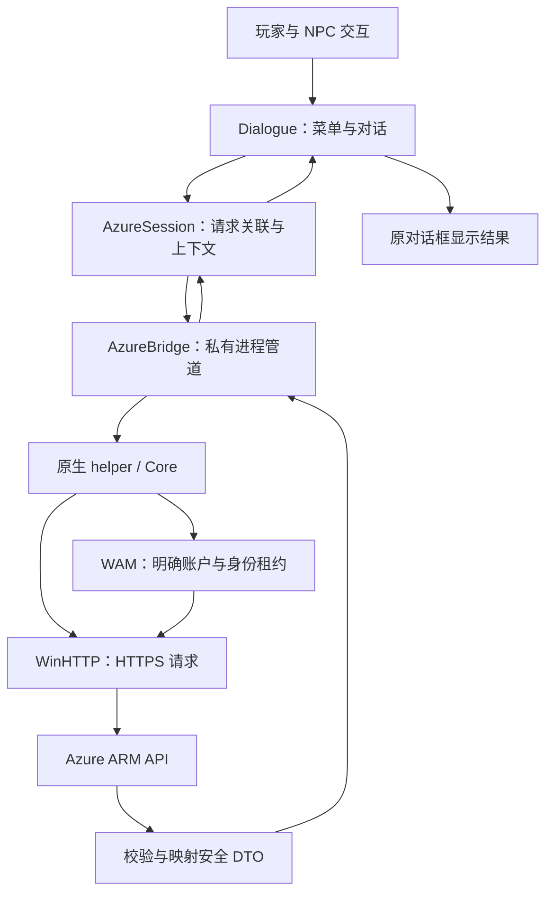

# 2026-10-09 开发记录：Godot 星灯旅店接入 Azure API

日期：2026-10-09  
项目：Godot / StarlightInn（星灯旅店）  
主题：开发环境落地、云端代码合并、WAM 认证修复、四位 NPC 的真实 Azure 查询，以及后续 API 能力扩展。

## 今日总结

今天把星灯旅店从“可以运行的离线演示游戏”，推进到“可以通过 Windows 原生身份认证访问真实 Azure 的交互式应用”。

核心变化不是增加一个独立的资源管理窗口，而是让游戏中的人物成为实际能力入口：未登录时保留演示玩法；登录后，同一批 NPC 的对话菜单切换为真实 API 查询，结果直接显示在原对话框中。

主要完成了以下工作：

- 安装并验证 Godot 开发环境，让项目能够导入、导出并在真实 Windows 桌面运行。
- 合并云端更新，保留本地改动，解决 VS Code 启动任务冲突。
- 重建普通版 Godot 游戏和独立原生 Azure 辅助程序，补齐完整便携交付目录。
- 参考已有 AzureRM-rust 项目的 WAM 实现，定位并修复原生异步等待问题。
- 对齐 WAM 请求参数，完善登录成功提示、错误显示和取消后的状态恢复。
- 实现四位 NPC 的真实只读职责，补充资源组查询。
- 验证请求关联、分页、明确选择、真实错误显示、迟到回复隔离，以及注销后恢复演示。
- 完成生产版桌面登录与查询验证，实际读取到 2 台 VM 和 6 个资源组；用户确认能力接入正常。

本轮交付聚焦“身份可靠、查询可用、交互直观”。真实写操作暂不开放给玩家；后续可以基于当前接口与安全边界逐步扩展。

## 工作回顾

### 开发环境安装与首次运行

开始时，本机已有 .NET SDK 和运行时，但没有可直接使用的 Godot 安装，也没有星灯旅店的 Windows 导出产物。

先执行仓库中的 `Install-Godot.ps1`，安装官方 Godot 4.7.2 .NET 编辑器及配套导出模板，复用已有 .NET 环境和 VS Code 扩展。编辑器与模板下载经过官方 SHA512 校验，并通过 GDScript、C# 运行及 Windows 导出验收。

随后导入星灯旅店素材、检查主场景，导出首个 Windows EXE，并打开真实游戏窗口。窗口能够响应，F1 指南可以正常打开和关闭，完成了“环境具备 → 项目能加载 → 产物能运行”的基础闭环。

后续真实 Azure 版本采用普通 Godot 加 GDScript，因此又补齐了项目内的普通版编辑器和模板。两个用途应分开理解：

| 环境 | 用途 |
|---|---|
| 用户目录中的 Godot .NET 编辑器 | 通用开发环境，保留 GDScript 与 C# 入口 |
| `StarlightInn/tools/godot-standard/` | 当前星灯旅店普通版导出工具与模板 |
| 已有 VS2022 C++ 工具链 | 编译原生 WAM / Azure helper |

当前玩家运行游戏不需要安装 .NET、MSAL、Azure CLI 或 PowerShell。源码侧的 PowerShell 脚本用于开发、构建与验收，不是游戏访问 Azure 的运行依赖。

### 合并云端代码

从 `origin/main` 获取云端提交 `a7e9ed6`，快进合并到本地 `main`。

这次云端更新包含原生 WAM/Azure 桥接、认证界面、音效和测试，也包含 HollowBell 的其他游戏更新。今天在此基础上继续处理星灯旅店的认证与 API 接入，没有重新实现整套游戏。

合并前用 Git stash 保存本地修改；恢复时只有 `.vscode/tasks.json` 出现内容冲突。云端新增《钟誓》启动任务，本地新增《星灯旅店》启动任务，最终保留两者，避免用一边覆盖另一边。

合并后进行了项目导入和定向离线验证，再继续重建。这一步确立了后续工作的源码基线，也说明“云端代码已合并”和“本机运行的 EXE 已更新”必须分别验证。

### 重建与交付整理

云端源码没有携带引擎下载包、导出模板和编译产物，直接导出会遇到环境缺项。

实际处理了两个构建问题：

- 构建脚本原先只查找固定 VS2022 Build Tools 路径，而本机已有其他 VS2022 版本。增加 `vswhere` 查找，复用已有 C++ 工具链。
- MSVC 输出的 `.obj` 被 Godot 误识别为 Wavefront OBJ 模型，产生资源导入错误。在原生构建输出目录加入 `.gdignore`，并由构建脚本自动生成，隔离中间文件。

原生编译采用 C++20、`/MT /W4 /WX`。编译环境只注入子进程，不修改用户或系统环境配置。生产 helper、共享核心测试、独立管道夹具和 discovery probe 分别生成；只交付生产 helper。

最终交付目录包含六个文件：

| 文件 | 作用 |
|---|---|
| `play/StarlightInn.exe` | 普通 Godot 导出的游戏，内嵌项目资源 |
| `play/native/StarlightAzure.exe` | 原生 WAM 与 ARM 能力执行程序 |
| `play/azure-settings.json` | 本应用公开 ClientId 与初始目录配置 |
| `play/README.md` | 游戏与使用说明 |
| `play/API.md` | 能力接口及协议说明 |
| `play/AAD_SETUP.md` | 应用注册、认证与权限配置说明 |

另生成 `StarlightInn/StarlightInn-Windows.zip`，便于完整复制交付。用户在游戏中保存的公开配置保持不变，没有用源码中的空模板覆盖它。

验包核对了最新 helper 与构建输出的哈希、交付文档与源码的一致性，以及 ZIP 内六个文件与磁盘文件的逐项哈希。构建目录、夹具和归档工程不进入玩家交付包。

## WAM 认证修复

### 问题表现

最初用户点击登录，在微软认证界面完成操作后回到游戏，没有看到正常的登录成功状态。登记簿显示 `AUTH_NATIVE_FAILED`，错误阶段为 `request_token`。

仅检查界面回调不足以定位这类问题。完整链路包括微软窗口、WinRT 异步操作、原生响应校验、helper 协议回包、GDScript 会话更新和 UI 刷新；任何一层没有完成，窗口返回都不能代表应用已经取得可用身份。

### 参考已验证的 Rust 实现

参考项目为 `C:/Scripts/projects/Set-PS-Studio-Firewall/AzureRM-rust`。

对比重点不是照搬整个项目，而是复用已经有效的身份交互逻辑：

- WAM provider 与 authority 的构造方式。
- ARM scope 与 provider properties 的请求配方。
- 首次登录、明确换账户和静默获取的区分。
- 父窗口 HWND 的传递。
- 异步操作如何等待完成、取消与返回结果。
- 返回账户及目录如何与当前上下文绑定。

保留当前 C++/WinRT helper 和 Godot 私有管道架构，修复实际差异，避免为了认证问题引入另一套运行时或服务。

### 根因：同一异步操作重复注册完成回调

旧实现循环调用同一个 WinRT operation 的 `wait_for(20ms)`。

关键问题在于：C++/WinRT 的该等待实现会设置 operation 的 `Completed` handler，而 WinRT 接口规定同一操作的 `Completed` 属性不能重复设置。第一次短等待超时后，再次调用会重复注册，导致 `E_ILLEGAL_DELEGATE_ASSIGNMENT`，错误码为 `0x80000018`。

这不是仅凭代码推测：定向测试使用实际延迟的 WinRT 异步操作，复现了旧等待方式的错误，再验证新实现可以正常取得结果。

修复后，`native/async_wait.hpp` 的 `await_native()`：

- 只注册一次 `Completed`。
- 使用条件变量等待本地完成通知，而不是反复注册 WinRT 回调。
- 定期检查既有取消标志与截止时间。
- 完成后调用 `GetResults()`。
- 出错或取消时调用 operation 的 `Cancel()`。
- 用共享回调状态保证取消返回后，可能迟到的完成回调仍有有效生命周期。

同一等待函数被 provider 查找、登录、静默取令牌、恢复及注销等路径复用。修复放在共用等待入口，而不是只为一个登录按钮增加例外处理。

### 请求参数与状态反馈

将 ARM 请求对齐为 AzureRM-rust 所使用的 scope-only WAM v2 配方：

| 内容 | 当前设置 |
|---|---|
| ARM 委托 scope | `https://management.azure.com/user_impersonation` |
| 身份辅助 scope | `openid profile offline_access` |
| authority | 指定初始或明确选择的目录 |
| `validateAuthority` | `yes` |
| `wam_compat` | `2.0` |
| `resource` | 不与上述 scope-only 配方混用 |

账户、provider、实际目录与 ARM scope 的校验仍保留。认证修复没有通过忽略身份错误、任意接受返回账户或自动借用其他应用凭据来实现。

界面同步完善了：

- 成功回包显示“已登录”、账户及下一步选择订阅的提示。
- 当前账户、目录和订阅显示在游戏中。
- 长 HRESULT / ProviderError 诊断能够换行，不再横向裁切。
- 取消登录、返回、关闭或切换上下文后，旧回包不能重新连接已取消的会话。

测试过程中还发现一个旧断言把 `0xCAA20008` 的十进制值写错。核对转换后，改用与原生夹具相同的十六进制字面量。这项修复针对测试数据，不是修改实际认证错误码。

## 四位 NPC 如何获取真实数据

### 同一游戏，两种明确模式

未登录时保留原有演示数据和本地对话；登录后，根据真实会话状态切换菜单。

| NPC | 未登录时 | 登录后 |
|---|---|---|
| 米拉 · 旅店主人 | 旅店向导、住客介绍、传说 | 查询目录和订阅，明确选择订阅 |
| 奥伦 · 云务管家 | 示例 VM 清单、离线关机流程预览 | 查询真实 VM，翻阅列表并明确选择目标 |
| 伊芙 · 星术鉴定师 | 示例资源属性、标签和概念讲解 | 读取选中真实 VM 的属性、标签与实例状态 |
| 菲恩 · 吟游诗人 | 本地故事、API 讲解、模板聊天 | 查询真实资源组，查看区域与标签 |

真实模式关闭自由聊天，避免把预设文本误解为联网 AI。当前没有接入 LLM。

登录后的结果直接进入原 NPC 对话框，不要求玩家到另一套账簿界面完成全部查询。HUD 登记簿主要承担公开配置、登录、换账户和注销。

### 查询顺序与上下文

推荐操作顺序：

- 找米拉读取订阅，明确选一个订阅。
- 找奥伦读取 VM，翻阅后明确选中一台。
- 找伊芙查看同一 VM 的属性和标签。
- 找菲恩读取当前订阅的资源组。

订阅和 VM 不自动选择第一项。选中目标使用完整 ResourceId，不用示例名字、显示名称或一个局部 ID 拼凑真实资源身份。

目录选择会进入新的授权上下文，订阅需要重新核对。普通查询不需要反复登录或切目录；应在用户实际需要切换时才改变上下文。

### 真实响应与演示响应不混用

原 `CapabilityPort` 继续维持演示契约。真实请求通过 `AzureSession` 和原生桥执行，两者没有通过放宽 `mode` 校验混成同一条路径。

重要行为包括：

- 真实请求失败显示真实错误，不用演示结果兜底。
- 未选择订阅时提示先选择，不制造默认目标。
- 未选真实 VM 时，伊芙提示先找奥伦选择。
- 返回、关闭或换 NPC 会取消本次本地等待，迟到结果不写入另一个人的对话。
- 注销后菜单恢复演示，但历史中的真实查询仍明确标注来源。
- 列表支持翻阅已加载项，也支持继续读取 API 下一页，避免静默截断。
- 真实结果立即显示并支持滚动，不被原有打字机效果拖延。

### 今天补充的资源组接口

为菲恩增加 `resource_groups` action，调用固定的 ARM 资源组列表接口：`GET /subscriptions/{subscriptionId}/resourcegroups?api-version=2021-04-01`。

返回给游戏的 DTO 包含 `id`、`name`、`region`、`tags`，以及列表的 `has_more` 和 `notice`。

接口校验当前订阅、返回资源路径和下一页地址。游戏不能向 helper 传入任意 REST URL，也不能通过请求参数读取任意 host。

## Godot 接入 API 的架构经验

### 把表现层与身份、网络、业务逻辑分开

当前真实能力链路为：

这种拆分让游戏不必承担 Windows 身份 SDK 的全部复杂性，也使业务动作能够脱离画面进行定向测试。

各层职责如下：

| 层次 | 核心职责 | 不应承担的职责 |
|---|---|---|
| 游戏与 UI | 菜单、按钮、状态、结果展示、玩家意图 | 管理 token、处理 OAuth 内部流程 |
| 对话模型 | NPC 分工、模式切换、对话生命周期 | 任意 URL 拼接与凭据存储 |
| 会话层 | 请求 ID、busy、选择、视图与上下文代次 | 用 UI 名称替代资源身份 |
| 管道桥 | helper 生命周期、分帧、超时、回包关联 | 暴露原始认证对象或 token getter |
| 原生身份层 | WAM 登录、静默获取、恢复和注销 | 自动选首个 Windows 账户 |
| 原生业务层 | 固定 action、参数校验、API 路径、DTO | 任意 REST 代理或未经确认的写入 |
| HTTP 层 | HTTPS、超时、响应大小与状态处理 | 将原始错误全文输出到游戏日志 |

独立 helper 是本项目的选择，不代表 Godot 必须通过外部程序才能调用所有 API。无特殊身份要求的轻量服务可以评估引擎内 HTTP 接口；需要复杂本地 SDK、Windows 原生认证或更严格凭据隔离时，当前拆分更容易管理边界。

### 用能力契约连接，而不是让 NPC 认识网络细节

NPC 发出的是“读取订阅”“读取 VM”“检查目标”“读取资源组”等业务动作，不是任意 HTTP 请求。

增加一个能力时，依次补充：

- 固定 action 与允许参数。
- 所需身份、目录和订阅上下文。
- API 路径及返回字段校验。
- 只向 UI 提供所需字段的 DTO。
- 会话层状态处理。
- NPC 菜单和结果呈现。
- 对应定向验证。

接口契约比引入某个 SDK 更重要。只要边界稳定，未来替换底层 HTTP 实现或接入另一种后端，不必重写大厅、移动和对话 UI。

### 令牌留在能力执行边界内

WAM 返回的 token 留在 helper 中，用于构造 WinHTTP 请求头；不会进入 GDScript、命令行参数、环境变量、临时文件或游戏历史。

应用自己的 DPAPI 档案保存的是偏好及账户、目录、订阅元数据。认证缓存由 WAM 管理，应用不维护一份明文 token 文件。

认证配置只需要本应用公开的 ClientId 和初始目录；公开客户端不把 client secret 放进游戏。密码和 MFA 由用户在微软认证窗口中处理。

这种做法不是依赖“不打印日志”这一条纪律，而是从接口上不给游戏 token 获取能力。

### 异步 API 必须与游戏生命周期一起设计

游戏有帧循环，而网络请求和身份窗口可能跨越多帧。玩家可能在请求完成前关闭对话、换 NPC、切订阅或注销。

因此请求关联不只检查一个“成功”字段，而要结合：

- 请求 ID。
- action。
- NPC 当前会话。
- 当前视图代次。
- 身份／订阅上下文 generation。
- 取消状态和截止时间。

同一个 NPC 关闭再打开，也应被视为新会话，不能收到上次的晚到结果。

当前 helper 通过 `OS.execute_with_pipe` 使用私有标准流通信，采用 UTF-8 JSON 换行分帧，并保留分片字节缓冲。单包和发送队列有上限，不能假设一次写入一定发送了完整消息，也不能假设一次读取就得到完整 JSON。

当 helper 退出、超时或协议出错时，UI 的等待状态必须释放，并给出可见反馈。用户返回取消的是本次等待；未来涉及云端写入时，还必须单独判断操作是否已经被服务端受理。

### API 数据要经过业务映射

ARM 原始响应不直接成为对话内容。

当前 DTO 映射处理了：

- 目录与订阅的 ID、名称。
- VM 的完整 ResourceId、资源组、区域、实例状态、属性和标签。
- 资源组的名称、区域与标签。
- 分页状态和查询提示。

缺失状态显示为 `unknown`，不能当作 `stopped`。VM 状态列表可能不包含完整规格和 OS 字段，因此详细属性由伊芙的 inspection 请求补充。

未来仍应优先按需读取，而不是每次对话抓取整个云资产的全部详情。列表、详情、监控和聚合应有各自的加载策略。

### 将认证成功、权限满足和业务成功分开

三个状态不等价：

- 微软窗口完成，不等于应用已成功接收并验证身份。
- 应用已登录，不等于用户拥有目标资源的访问权限。
- API 返回受理，不等于长时间操作已经完成。

对于查询，需明确区分空列表、未选订阅、401、403、超时和服务异常。403 应保留为访问被拒绝的事实，再调查 RBAC、组织策略或环境限制，不能仅凭状态码直接判定唯一原因。

对于后续写操作，不能把 202、submitted 或 pending 显示成“成功”。

### 构建与运行也属于能力接入的一部分

源码中的认证逻辑正确，并不代表玩家已经在运行正确产物。今天反复区分了三个层次：

- 源码是否已修改。
- 游戏与 helper 是否由最新源码构建。
- 实际运行是否进入目标路径。

同时注意：

- `.gdignore` 负责阻止引擎扫描开发目录；导出排除规则负责控制交付内容，二者不能互相替代。
- helper 的编译环境应局限在构建子进程，不为一个项目污染系统设置。
- 引擎版本与导出模板需要匹配，普通版与 .NET 版的用途不能混淆。
- 更新时复制完整交付目录，不能只换游戏 EXE 而漏掉 helper。
- 配置属于用户已保存的数据，不能被每次重建的模板覆盖。

## 验证结果与当前状态

### 定向回归

本轮围绕具体缺陷和新能力进行验证，重点是请求行为和状态变化，而不是追求累计断言数量。

| 验证 | 已确认结果 | 执行阶段 | 覆盖重点 |
|---|---:|---|---|
| 原生共享核心 | 387 通过 / 0 失败 | 认证修复后定向验证 | WinRT 等待对照、取消与期限、资源组 DTO、身份与请求安全边界；身份及 HTTP 使用合成实现 |
| 实际私有管道 | 210 通过 / 0 失败 | 认证修复后定向验证 | 真实 Godot 与独立夹具进程通信、UTF-8 分片、关联、故障、超时、取消和清理 |
| 登记簿 UI | 185 通过 / 0 失败 | 认证修复后定向验证 | 真实主场景与 Controls、登录提示、恢复取消、明确订阅选择、长诊断和无写按钮 |
| NPC 查询路由 | 40 通过 / 0 失败 | 认证修复后定向验证 | 四 NPC 菜单、明确选择、分页、错误不 fallback、迟到回复隔离、注销恢复演示 |
| 原有离线对话 | 423 通过 / 0 失败 | 此前的 NPC 接入阶段 | 保留本地分支、输入、历史和演示契约 |
| 大厅回归 | 5112 通过 / 0 失败 | 此前的 NPC 接入阶段 | 新能力接入后原场景、移动、导航与交互的既有回归 |

其中合成身份/HTTP 回归验证逻辑合同，私有管道验证真实进程通信，主场景测试验证真实节点与 Controls；它们与真人登录和真实云查询是不同层面的证据。

### 真实桌面验证

后续用户完成了真实 WAM 登录，界面能够显示账户、实际目录和选定订阅，并确认能力接入正常。

在生产版游戏窗口中复用既有账户进行验证：

- 启动后的静默恢复成功，恢复了明确账户和已保存订阅。
- 奥伦通过真实 VM 查询返回 2 台 VM，分别显示运行中和已解除分配状态。
- 通过明确选择 VM 后进入伊芙的 inspection 请求，查询完成并进入结果页。
- 菲恩通过真实资源组 API 返回 6 个资源组，并显示区域和标签。
- 请求后的等待状态正常释放；观察到的云操作记录数为 0。

查询数量反映当时选定订阅的数据，不是产品内置样本数，也不代表其他订阅会返回相同结果。

用户确认“能力接入 OK”，当前已完成从认证、会话恢复到 NPC 实际取数的关键闭环。

### 保留的改进项

- 部分退出路径仍出现 Godot ObjectDB / 资源释放诊断，后续应单独定位生命周期与释放顺序。
- 当前列表更侧重可靠与简单，完整 ResourceId、长标签和大量资源的展示仍可继续优化。
- 复杂跨目录、不同组织策略和不同权限范围需要按实际使用场景继续验证。
- 真实云端写操作及其完整审计、恢复机制尚未作为玩家能力交付。
- 当前操作记录只在进程内保留，不具备跨进程持久任务恢复。

## 未来扩展路线

### 第一阶段：丰富只读能力

优先沿用现有 action、上下文、分页和 DTO 机制，增加更多真实数据，而不是先做复杂自动化。

可选方向：

| 方向 | 用户能获得什么 | 建议接入方式 |
|---|---|---|
| 资源清单与筛选 | 按资源组、类型、名称、标签查看资源 | 新增固定查询 action、分页与过滤条件 |
| VM 详情 | 网络、磁盘、规格、OS、实例状态 | 区分列表 DTO 与详细 DTO，按需加载 |
| 标签与配置分析 | 展示缺少标签、命名不一致等问题 | API 取数后进行本地确定性规则分析 |
| 监控指标 | CPU、网络、磁盘等时间段指标 | 明确资源、时间范围、指标与采样粒度 |
| 日志查询 | 读取限定范围的运行或审计信息 | 单独设计查询权限、参数、结果大小与敏感字段处理 |
| 费用信息 | 成本摘要、资源费用趋势 | 使用相应 API 与权限，不根据资源状态猜测账单 |
| 对比与导出 | 两次查询差异、CSV/JSON 报告 | 为数据记录查询时间、范围和来源，导出安全 DTO |

每项新能力都需要重新核对目标 API、scope／权限、分页、限流和结果结构。不能把当前 ARM 查询权限当作所有 Microsoft 云接口的通用授权。

### 第二阶段：从读取升级到分析与建议

高级处理不一定需要云端写入。

可以先把 API 数据加工成更有用的结果：

- 合并多个资源组或订阅的查询结果。
- 按标签、状态、区域、规格聚合统计。
- 比较两次读取的资产差异。
- 识别配置缺项或明显不一致。
- 生成带依据的检查清单和处理建议。
- 将大结果整理成游戏内可翻阅的卡片或报告。

推荐形成“读取 → 校验 → 归一化 → 分析 → 展示”的管线。分析规则与联网代码分离，同一份已验证数据可以被多个 NPC 使用，而不重复请求。

需明确区分原始事实和推导结论。比如“VM 已解除分配”来自实例状态；“适合删除”“没有业务价值”不能仅据此推导，必须结合更多信息及用户意图。

### 第三阶段：开放受控写操作

若后续需要启动、停止、修改标签或其他处理，应以明确的业务 action 开放，而不是给 NPC 一个任意 REST 执行入口。

现有原生层保留了 `prepare`、`execute`、操作记录及轮询的兼容机制，可作为基础。开放玩家入口前，仍需要针对目标动作进行真实验收。

建议流程：

关键边界：

- 显示账户、目录、订阅、完整目标和具体动作。
- 展示成本、停机、数据或其他业务影响。
- 确认短时有效、一次消费，不能被重用。
- 提交前重新读取目标，校验上下文和目标状态。
- 获取令牌后、紧贴实际发送前再做最终检查。
- 对重复点击、重复请求和同一目标的在途任务进行限制。
- 受理未知时先核对原操作，不能盲目重发。
- 将 401 的有限刷新与网络不确定结果的处理区分开。
- 关闭对话或退出游戏不表示已经撤销云端操作。

不同 API 的幂等语义不同，不能把“最多重试一次”作为所有写操作的统一规则。

### 第四阶段：批量处理与长时间工作流

复杂处理可能包含多个步骤、多项资源以及分钟级执行时间，届时不应继续把一切塞进一次 NPC 请求。

建议将工作流拆成：

- 计划：固定目标范围、前置条件、步骤与影响。
- 执行：按依赖顺序运行，每步有独立动作和结果。
- 观察：显示进度、等待服务端结果、错误与待核对状态。
- 恢复：明确可继续、可跳过或需要人工处理的步骤。
- 审计：保留用户意图、确认内容、请求关联与结果摘要。

批量处理应具备预览、范围与数量限制、受控并发、分页及限流策略；一个目标失败不应悄悄隐藏，也不应自动把全部资源再执行一遍。

跨进程恢复需要新增持久化任务模型。恢复时必须重新验证账户、权限和原资源，不能因为本地文件写着“未完成”就重新提交云操作。

回滚也不是所有 API 都天然具备的能力。应区分真正可逆操作、可补偿操作和只能人工处置的不可逆操作，并在确认前说明。

### 第五阶段：AI 辅助与多 NPC 编排

未来可以让 NPC 从固定菜单升级为理解用户意图、组织查询、解释结果和提出计划，但实际 API 调用仍应通过当前确定性能力边界。

推荐分工：

- AI 理解自然语言，产出结构化查询或处理建议。
- 确定性代码校验 action、参数、身份、权限与资源范围。
- 用户确认需要写入或高影响的步骤。
- 现有能力执行层调用固定 API。
- UI 展示真实结果，AI 只能基于可追溯的返回数据解释。

模型不应持有 token，也不能自行构造任意 URL 或绕过确认。资源名称、标签、日志和 API 返回内容属于外部数据，不能因为出现在文本中就变成执行指令。

涉及真实 AI 服务时，另行设计模型服务配置、权限、数据发送范围、日志与费用边界，不把现有本地 `ai.chat` 模板接口直接伪装成真实模型调用。

四位 NPC 可以逐步形成稳定职责：米拉管理会话与范围，奥伦负责资源清单和计划，伊芙负责检查与影响分析，菲恩负责汇总解释和报告。高级编排应建立在可靠的单项能力之上。

## 后续新增一个 API 能力的工作顺序

后续开发可按以下顺序落地：

- 明确玩家要完成的业务任务，以及由哪位 NPC 提供入口。
- 核对官方 API、身份资源、权限、参数和分页语义。
- 设计固定 action 与安全 DTO。
- 实现原生查询或服务适配，限制 URL、参数和响应规模。
- 接入会话层关联、busy、取消与错误处理。
- 设计 NPC 的菜单、选择、结果与反馈。
- 补最小充分的定向测试，覆盖新增能力和具体风险。
- 通过当前登录身份进行真实只读验收；写能力另做明确确认与结果核对。
- 重建游戏与 helper，验证发布目录、用户配置和运行路径。

不要跳过“用户看到了什么”这一层。API 200、内部 DTO 正确、界面显示成功，分别是不同检查点。

## 今日形成的实践结论

- Godot 可以作为真实业务能力的交互入口，NPC 不只承担故事展示，也能承担明确的业务职责。
- 游戏表现、身份认证、API 执行和业务分析应分层，避免 UI 与凭据及网络细节耦合。
- 参考已有可用项目时，应对齐关键请求和生命周期逻辑，而不是凭印象重写另一套架构。
- 认证窗口返回后，必须以完整回包和状态更新确认应用连接；本次 WinRT 完成回调问题说明异步等待本身也属于认证正确性。
- 演示模式和真实模式必须让用户看得懂，真实失败不能被示例数据掩盖。
- 高级能力的基础是固定 action、明确上下文、完整目标、可见结果和安全生命周期，而不是无限制的 API 访问。
- 先把单项只读能力做可靠，再加入分析、确认写入、批量工作流和 AI 编排，是更可控的扩展路径。

今天已经完成“可运行游戏 → 原生认证 → 真实会话 → NPC 查询 → 可交付产物”的闭环。下一阶段可以继续丰富查询与结果分析，并在需要时把成熟的 API 能力组合成更高级的处理方案。
